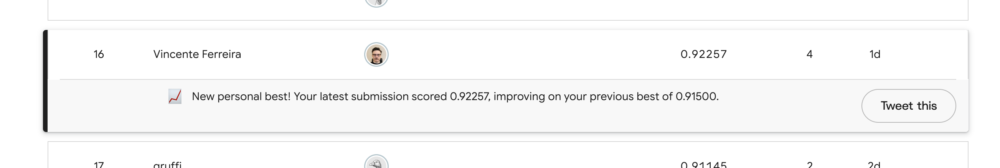

# Flower classifier — 104 species

A FastAPI service that takes a single flower photo and returns its species
together with the probabilities of all 104 classes.

The model is EfficientNet-B0 fine-tuned in PyTorch on the Kaggle competition
[Petals to the Metal — Flower Classification on TPU](https://www.kaggle.com/competitions/tpu-getting-started),
exported to ONNX and served with **onnxruntime on CPU** — no PyTorch at runtime.

---

## Kaggle result

| |                                     |
|---|-------------------------------------|
| Kaggle user | [vincenteferreira](https://www.kaggle.com/vincenteferreira) |
| Public leaderboard accuracy | **0.92257**                         |
| Leaderboard place | `16` (as of 21 Oct 2026)            |



---

## Quick start

```bash
docker compose up --build
```

That's it. The service starts on **http://localhost:8000**.
The model and the class list are part of the repository and are baked into the image:
nothing is downloaded at startup, no extra setup is needed.

Health:

```bash
curl http://localhost:8000/health
# {"status":"ok"}
```

A flower photo → `200` with `class_id`, `class_name` and 104 probabilities:

```bash
curl -F "file=@tests/data/53_sunflower.jpg" http://localhost:8000/predict
# {"class_id":53,"class_name":"sunflower","probabilities":[...104 numbers...]}
```

Not an image → `400`:

```bash
curl -w ' %{http_code}\n' -F "file=@README.md" http://localhost:8000/predict
# {"detail":"file is not a valid JPEG or PNG image"} 400
```

Empty file → `400`:

```bash
curl -w ' %{http_code}\n' -F "file=@/dev/null" http://localhost:8000/predict
# {"detail":"file is empty"} 400
```

More than one photo → `400`:

```bash
curl -w ' %{http_code}\n' \
  -F "file=@tests/data/53_sunflower.jpg" \
  -F "file=@tests/data/53_sunflower.jpg" \
  http://localhost:8000/predict
# {"detail":"exactly one image is allowed"} 400
```

---

## API

### `GET /health`

`200 {"status": "ok"}` — returned **only after the model has loaded successfully**.
If the model is missing, broken or incompatible, the service does not start at all,
so `/health` never answers `200` and the container never becomes healthy.

### `POST /predict`

`multipart/form-data` with exactly one field **`file`** — a single JPEG or PNG image.

**Response `200`**

```json
{
  "class_id": 53,
  "class_name": "sunflower",
  "probabilities": [0.0001, 0.0, "... 104 numbers ..."]
}
```

| Field | Meaning |
|---|---|
| `class_id` | integer `0–103`, line index in [`model/classes.txt`](model/classes.txt) |
| `class_name` | that line of `classes.txt` — the competition label |
| `probabilities` | 104 numbers, sum ≈ 1, `argmax(probabilities) == class_id` |

**Errors — `400` with a short `detail`**

| Case | `detail` |
|---|---|
| more than one file | `exactly one image is allowed` |
| no `file` field | ``field `file` with an image is required`` |
| body is not a multipart form | ``request must be multipart/form-data with a `file` field`` |
| empty file | `file is empty` |
| file > 20 MB | `file is too large` |
| GIF, BMP, WebP, … | `only JPEG or PNG images are accepted` |
| text, corrupted or truncated image | `file is not a valid JPEG or PNG image` |
| image > 50 MP | `image is too large` |
| shorter side < 32 px | `image is too small` |
| aspect ratio > 10 | `image aspect ratio is too extreme` |

The format is detected from the **file content**, not from its name or `Content-Type`.

---

## How it works

```
 photo bytes
     │
     ▼
 images.decode_image     validate: not empty, size limit, real JPEG/PNG, dimensions, fully decodable
     │
     ▼
 preprocess.preprocess   EXIF orientation → RGB → resize short side to 331 → center crop 331×331
     │                   → [0, 1] → ImageNet mean/std → float32 (1, 3, 331, 331)
     ▼
 model.onnx              EfficientNet-B0 + softmax → 104 probabilities
     │
     ▼
 {class_id, class_name, probabilities}
```

### Model

| | |
|---|---|
| Architecture | EfficientNet-B0 (torchvision, ImageNet weights), classifier head replaced with 104 outputs |
| Training data | competition TFRecords `331×331`, train split; model selection on the val split |
| Training | 10 epochs, AdamW (lr 3e-4), cosine LR schedule |
| Augmentations | RandomResizedCrop (scale 0.7–1.0), horizontal flip, AutoAugment (ImageNet policy) |
| Validation accuracy | 0.94 |
| Export | ONNX opset 17, **softmax included** — the model outputs probabilities directly |
| Input / output | `input: float32 (batch, 3, 331, 331)` → `probs: float32 (batch, 104)` |
